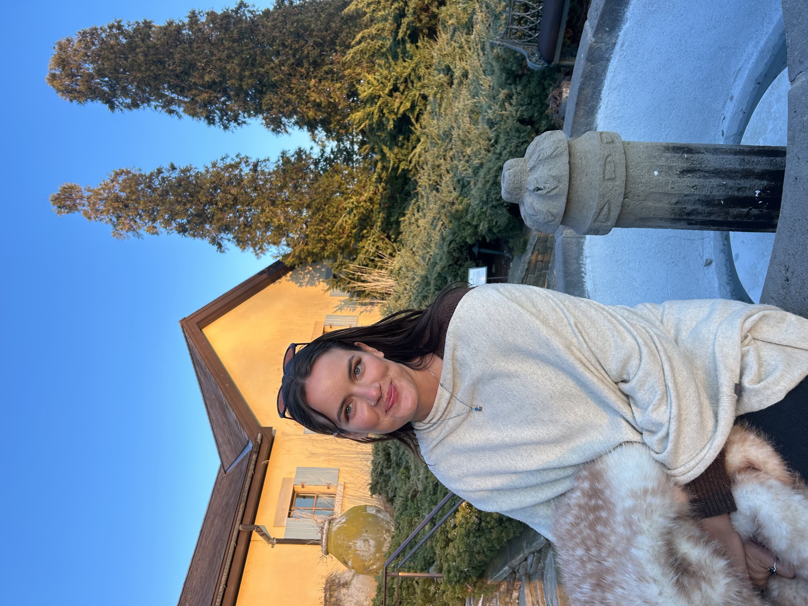

Hi, I'm Lina! I'm a Master's student in Biostatistics at Columbia University's Mailman School of Public Health, pursuing the statistical genetics track.

Before starting my degree, I spent several years in clinical and translational research at Columbia University Medical Center, studying neurodegenerative disease biomarkers and coordinating clinical studies in cystic fibrosis. I'm now building on that experience with further education in statistics and data science, and I'm especially interested in how genetics and data can help us understand disease.

Outside of research, I enjoy logic puzzles, chess, poker, volunteering, and global health policy.

You can find my full [resume](resume.html) here.